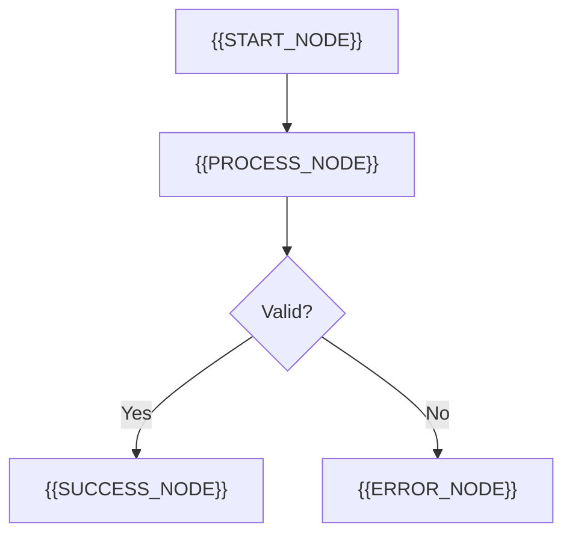
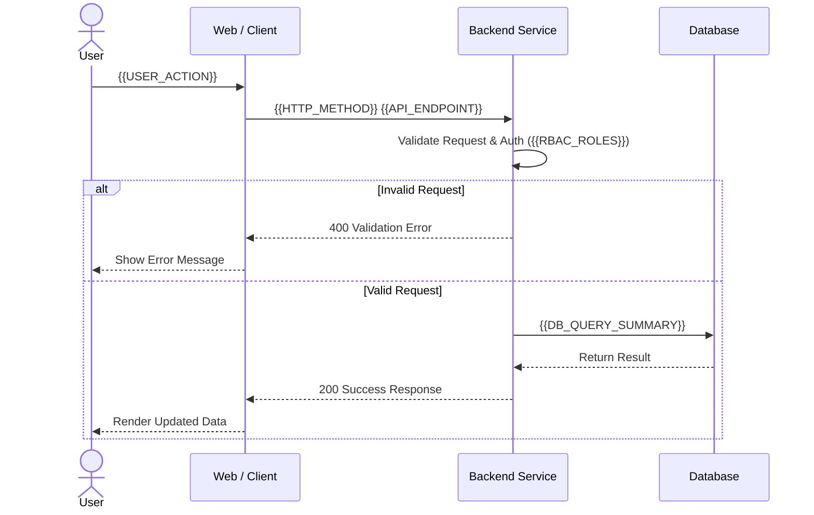

# TRD: {{FEATURE_NAME}}

> **Status Dokumen:** TRD Aktif (`sura-memory/TRD/TRD.md`)
> **Aturan Rotasi:** Dokumen ini selalu diingat AI selama mengerjakan proyek/fitur aktif ini. Saat proyek/fitur ini selesai (`update sura`) dan berpindah ke proyek berikutnya, dokumen ini diarsipkan ke `sura-memory/TRD/archive/YYYY-MM-DD-<slug>/` dan TRD proyek baru dibuat dari template.

| **Document Name** | **Document Link** |
|---|---|
| **Product Requirement Development (PRD)** | [{{FEATURE_NAME}}](PRD.md) |
| **Design** | {{DESIGN_URL}} |
| **Role Base Access Control** | {{RBAC_ROLES}} |
| **Target Audience** | {{TARGET_AUDIENCE}} |
| **Repo Mode** | `{{REPO_MODE}}` *(Existing Repo — dipelajari via Graphify / Greenfield — dirancang dari nol)* |
| **Project Scope & Test Mode** | Scope: `{{PROJECT_SCOPE}}` · Test Mode: `{{TEST_MODE}}` |
| **Implementation Status** | {{STATUS}} *(Draft / In Progress / Done — PR #{{PR_NUMBER}})* |

# Components

> *Diisi untuk proyek `frontend` atau `fullstack`. Untuk `backend` murni, ringkas konteks pemanggilnya.*

| **Scope** | **Screen Shot / UI Ref** | **Description** |
|---|---|---|
| **{{COMPONENT_1_SCOPE}}** | {{SCREENSHOT_OR_LINK_1}} | 1. Integrasi API untuk {{COMPONENT_1_PURPOSE}}<br>2. Pagination: {{PAGINATION_RULE}}<br>3. Search / Filter: {{SEARCH_FILTER_RULE}}<br>4. Ordering default: `{{DEFAULT_SORT}}`<br>Data / Kolom yang ditampilkan:<br>- {{COLUMN_1}}<br>- {{COLUMN_2}}<br>**Related API:**<br>`{{METHOD}} {{ENDPOINT_PATH}}`<br>**Related File:**<br>1. `{{FE_FILE_PATH_1}}`<br>**Blocker:**<br>- {{BLOCKER_IF_ANY}} |

# Flow

## Flow Chart



## Sequence Diagram



# API

> *Diisi untuk proyek `backend`, `fullstack`, atau `apidef`.*

## {{API_1_NAME}}

| Endpoint | : | `{{API_1_PATH}}` |
|---|---|---|
| Status | : | `NEW` / `EXISTING` |
| Method | : | `{{API_1_METHOD}}` *(GET / POST / PUT / PATCH / DELETE)* |
| Description | : | `operationId = {{API_1_OPERATION_ID}}` |
| Auth / Header | : | `Bearer Token`, `APP-TYPE={{APP_TYPE}}` |
| Query Param | : | ```json
{{API_1_QUERY_PARAMS}}
``` |
| Request Body | : | ```json
{{API_1_REQUEST_BODY}}
``` |
| Response Body | : | ```json
{{API_1_RESPONSE_BODY}}
``` |
| Related File | : | - `{{BE_HANDLER_FILE}}`<br>- `{{BE_SERVICE_FILE}}`<br>- `{{BE_REPO_FILE}}` |

# Database & Blast Radius (Graphify / Blueprint Analysis)

## 1. Database Schema & Migration
- **Migration SQL Required:** `Ya` / `Tidak`
- **Tabel Terkait:** `{{TABLE_NAMES}}`
- **Catatan Query / Index:** {{DB_NOTES}}

## 2. Blast Radius & Komponen (Existing Repo vs Greenfield)
- **Komponen yang Di-reuse (Jika Repo Existing) / Struktur Modul Baru (Jika Greenfield):**
  - `{{REUSED_OR_NEW_MODULE_1}}` (`{{FILE_PATH}}`)
- **File Wajib Disentuh / Dibuat:**
  - `{{TOUCHED_FILE_1}}`
  - `{{TOUCHED_FILE_2}}`
- **File Dilarang Disentuh:**
  - `{{FORBIDDEN_FILE_1}}` *(cth: migrations/, wire.go, atau modul lain)*

# Test Plan & Verification (`TEST_MODE`: `{{TEST_MODE}}`)

| Layer / Scope | Skenario Verifikasi | Perintah Eksekusi | Status |
|---|---|---|---|
| **Repository / Data** | Happy path, filter/pagination, empty data, DB error | `{{TEST_COMMAND}}` | [ ] |
| **Service / Logic** | Aturan bisnis, kalkulasi otomatis, error propagation | `{{TEST_COMMAND}}` | [ ] |
| **Handler / UI** | Validasi input (200 vs 400), render komponen | `{{TEST_COMMAND}}` | [ ] |
| **Lint & Build Gate** | Format bersih (0 error) & kompilasi berhasil | `{{LINT_COMMAND}} && {{BUILD_COMMAND}}` | [ ] |

# Tasks

| **Task** | **Assignee** | **Story Point** | **Status** |
|---|---|---|---|
| **[APIDEF]** Define `{{API_1_METHOD}} {{API_1_PATH}}` (`{{API_1_OPERATION_ID}}`) | @{{DEVELOPER_NAME}} | {{SP_APIDEF}} | [ ] |
| **[BE]** Implement Handler, Service, & Repository for `{{API_1_OPERATION_ID}}` | @{{DEVELOPER_NAME}} | {{SP_BE}} | [ ] |
| **[FE]** Build UI Components & Integrate `{{API_1_METHOD}} {{API_1_PATH}}` | @{{DEVELOPER_NAME}} | {{SP_FE}} | [ ] |
| **[VERIFY]** Run `/verify` gate (Test/Lint/Build) & Open PR | @{{DEVELOPER_NAME}} | {{SP_VERIFY}} | [ ] |
| | **SUM** | **{{SP_TOTAL}}** | |

# Note / Reference

- **Related Routes / Endpoints:**
  - `{{RELATED_ROUTE_1}}`
- **Implementation Notes (Di-update saat `"update sura"`):**
  - {{IMPLEMENTATION_REALIZATION_NOTES}}
